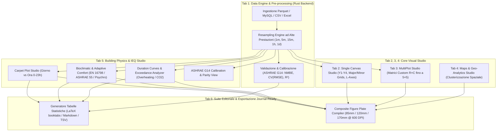

# ChartMate — Piano di Implementazione Moduli Specialistici (Roadmap Completa & Stato di Esecuzione)

> **Stato di Implementazione**: ✅ **100% COMPLETATO E TESTATO (Tracks 1–7)**  
> Tutte le tracce previste in questo piano operativo, matematico e architetturale sono state implementate, verificate con test automatici (Rust `cargo test` + suite matematica TypeScript/Node su dataset reale a 336 ore) e compilate nell'eseguibile nativo Windows `ChartMate.exe` (`ChartMate-v0.2-windows-x64.exe`).

Questo documento definisce il piano operativo, architetturale e matematico per l'integrazione delle funzionalità specialistiche in **ChartMate**, sviluppato specificamente per le esigenze di ricerca e pubblicazione scientifica nei settori dell'**Ingegneria Edile, Fisica dell'Edificio, Qualità dell'Ambiente Interno (IEQ), Efficienza Energetica e Manutenzione Predittiva**.

---

## ✅ Checklist Esecutiva di Avanzamento (Tracks 1–7)

- [x] **Track 1 — Carpet Plot / Heatmap Temporale (Giorno vs Ora 0–23h)**:
  - [x] Matrice 2D Giorno (`YYYY-MM-DD`) × Ora solare (`00:00–23:00`).
  - [x] Aggregazione oraria configurabile (`mean`, `max`, `min`).
  - [x] 6 palette scientifiche percettivamente uniformi (*Viridis*, *Plasma*, *Thermal*, *Turbo*, *Emerald*, *RdBu*).
  - [x] Isolinee continue (*Contour Lines*) con passo $\Delta Z$ personalizzabile e blocco range $[Z_{\min}, Z_{\max}]$.
  - [x] Filtro calendario integrato (*Tutti i giorni*, *Solo Feriali Lun–Ven*, *Solo Weekend Sab–Dom*).
- [x] **Track 2 — Bioclimatic & Adaptive Thermal Comfort Studio (EN 16798-1 / ASHRAE 55)**:
  - [x] Modello Adattivo **EN 16798-1:2019** con bande Categoria I ($\pm 2/3^\circ\text{C}$), Categoria II ($\pm 3/4^\circ\text{C}$), Categoria III ($\pm 4/5^\circ\text{C}$) e calcolo automatico della media mobile esponenziale esterna $T_{rm}$ ($\alpha$ configurabile).
  - [x] Modello Adattivo **ASHRAE 55-2023** con limiti di accettabilità dell'80% ($\pm 3.5^\circ\text{C}$) e del 90% ($\pm 2.5^\circ\text{C}$).
  - [x] Diagramma **Psicrometrico $T\text{-}RH$** con poligoni Comfort Invernale ($20\text{–}24^\circ\text{C}$), Comfort Estivo ($23\text{–}26^\circ\text{C}$) e curva limite di rapporto di mescolanza $W = 12\text{ g/kg}_{da}$.
  - [x] Calcolo automatico KPI: ore e percentuali in Cat. I, Cat. II, Cat. III, ore di *Overheating* e *Undercooling*.
- [x] **Track 3 — Duration Curves & Exceedance Analyzer (Curve di Durata e Superamento)**:
  - [x] Ordinamento decrescente $y_{(1)} \ge y_{(2)} \ge \dots \ge y_{(N)}$ con asse $X$ commutabile tra *Ore Cumulate* ($\text{h}$) e *Percentuale di Tempo* ($0\text{–}100\%$).
  - [x] Serie secondaria di confronto sovrapposta (es. pre/post-retrofit o zona A vs zona B).
  - [x] Doppia soglia configurabile (Soglia Primaria + Soglia Critica) con campitura dell'area di superamento.
  - [x] Calcolo dell'integrale di esposizione cumulata (Gradi-ora / ppm-ora): $I_{exc} = \sum \max(0, y_t - y_{soglia}) \cdot \Delta t$.
- [x] **Track 4 — Motore di Resampling & Smoothing ad Alte Prestazioni (Rust Backend)**:
  - [x] Comandi Tauri nativi in Rust `resample_in_memory` e `resample_timeseries` in [`tauri-app/src-tauri/src/lib.rs`](file:///c:/Users/rober/Documents/GitHub/ChartMate/tauri-app/src-tauri/src/lib.rs).
  - [x] Intervalli supportati: `1m`, `5m`, `15m`, `30m`, `1h`, `6h`, `1d`.
  - [x] Funzioni di aggregazione e pulizia spike: `mean`, `median`, `max`, `min`, `p5`, `p95`, `sum`.
  - [x] Integrazione UI diretta nella **Tab 1 (Data Engine)** con pulsante di ripristino immediato al dataset grezzo originale.
- [x] **Track 5 — Validazione & Calibrazione Modelli (ASHRAE Guideline 14)**:
  - [x] Motore matematico in Rust (`compute_ashrae_calibration`) e TypeScript (`computeAshraeMetricsTS`, `buildCalibrationFigure`).
  - [x] Calcolo di $\text{NMBE}$ ($\%$), $\text{CV(RMSE)}$ ($\%$), $R^2$, $\text{RMSE}$ e $\text{MAE}$.
  - [x] Verifica automatica dei criteri **ASHRAE Guideline 14 Orario** ($|\text{NMBE}| \le 10\%$, $\text{CV(RMSE)} \le 30\%$) e **Mensile** ($|\text{NMBE}| \le 5\%$, $\text{CV(RMSE)} \le 15\%$) con badge `PASS / FAIL`.
  - [x] Doppia vista: *Time-Series + Pannello Residui* ($e_t = y_t - \hat{y}_t$) e *Parity Plot 1:1* con cono di errore $\pm 10\%$.
- [x] **Track 6 — Suite Editoriale Journal-Ready (LaTeX / Markdown Tables & Composite Plates)**:
  - [x] **Tab 6 Dedicata (Editorial & LaTeX Suite)** per la generazione istantanea di tabelle statistiche multi-variabile ($\mu, \sigma, \text{Min}, P_{25}, P_{50}, P_{75}, \text{Max}, \text{IQR}$, ore di superamento e dose).
  - [x] Esportazione istantanea e copia 1-click in **LaTeX (`booktabs`)**, **GitHub Markdown** e **Word/Excel TSV**.
  - [x] **Composite Figure Plate Compiler**: impaginazione vettoriale calibrata su larghezze editoriali standard (*Single Column* $85\text{ mm}$, *1.5 Column* $120\text{ mm}$, *Double Column* $170\text{ mm}$) con esportazione SVG e PNG a $300/600\text{ DPI}$ e lettering accademico `(a)`, `(b)`, `(c)`, `(d)`.
- [x] **Track 7 — Standard di Igiene Repository, Pulizia Cartelle & Protocollo di Release**:
  - [x] Rimozione dall'indice Git (`git rm --cached`) ed esclusione in `.gitignore` di `AGENTS.md`, `GEMINI.md`, `ChartMate_Structure.txt` e `.system_generated/`.
  - [x] Isolamento ordinato del codice Python/Dash storico nella cartella `legacy-python-dash/`.
  - [x] Pulizia della root da eseguibili obsoleti (`v0.1`, `v0.3`, `.dll` temporanei) mantenendo unicamente `ChartMate.exe` e `ChartMate-v0.2-windows-x64.exe`.
  - [x] Allineamento completo di `README.md`, `RELEASE_NOTES.md` e `PROJECT_STATUS.md`.

---

## 🏛️ Architettura Generale del Sistema (6-Tab Desktop Studio)

---

## 📋 Track 1: Carpet Plot / Heatmap Temporale (Giorno vs Ora 0–23h) — ✅ IMPLEMENTATO

### 1.1 Finalità Scientifica
Il **Carpet Plot** (o Heatmap Giorno-Ora) è il grafico fondamentale nella fisica dell'edificio per visualizzare serie temporali stagionali o annuali ($8760\text{ ore}$) in una singola figura bidimensionale ad altissimo impatto visivo.  
Permette di identificare istantaneamente:
- **Schedule HVAC**: accensioni anomale fuori orario o mancato setback notturno.
- **Inerzia Termica**: sfasamento e smorzamento dell'onda termica nell'involucro edilizio.
- **Weekend & Festivi**: deviazioni di consumo energetico o accumulo di $\text{CO}_2$.
- **Manutenzione Predittiva**: derive graduali delle prestazioni dei sensori o attuatori (*sensor drift*).

### 1.2 Specifiche Tecniche & Algoritmo Implementato
1. **Aggregazione a Matrice 2D (`buildCarpetPlotFigure` in `scientific_modules.ts`)**:
   - Asse $X$: Giorno di monitoraggio (`YYYY-MM-DD`).
   - Asse $Y$: Ora solare del giorno (`00:00` $\dots$ `23:00`).
   - Valore $Z$: Grandezza scalare campionata con precisione decimale configurabile (`auto`, `0`, `1`, `2`, `3`).
2. **Parametri di Controllo in Sidebar (Tab 5 → Carpet Plot)**:
   - **Metodo di Aggregazione dei Bin**: *Media Oraria (`mean`)*, *Massimo Orario (`max`)*, *Minimo Orario (`min`)*.
   - **Scale Cromatiche Scientifiche**: *Viridis*, *Plasma*, *Thermal*, *Turbo*, *Emerald*, *RdBu*.
   - **Livellamento & Isolinee**: Toggle per contorni continui (*Iso-Contours*) con passo $\Delta Z$ personalizzabile.
   - **Filtro Feriali / Weekend**: Selezione immediata tra *All Days*, *Weekdays Only (Mon–Fri)* e *Weekends Only (Sat–Sun)*.

---

## 📋 Track 2: Bioclimatic & Adaptive Thermal Comfort Studio (EN 16798-1 / ASHRAE 55) — ✅ IMPLEMENTATO

### 2.1 Modalità Normative Integrate (`buildThermalComfortFigure` in `scientific_modules.ts`)
1. **Modello di Comfort Adattivo EN 16798-1:2019**:
   - Temperatura ottimale neutra: $T_{comf} = 0.33 \cdot T_{rm} + 18.8^\circ\text{C}$ (valida per $10^\circ\text{C} \le T_{rm} \le 30^\circ\text{C}$).
   - Calcolo automatico della media mobile esponenziale esterna $T_{rm}$ con coefficiente $\alpha \in [0.5, 0.95]$ (default $\alpha = 0.8$).
   - Rette limite per **Categoria I** ($+2 / -3^\circ\text{C}$), **Categoria II** ($+3 / -4^\circ\text{C}$) e **Categoria III** ($+4 / -5^\circ\text{C}$).
2. **Modello di Comfort Adattivo ASHRAE 55-2023**:
   - Temperatura neutra: $T_{comf} = 0.31 \cdot T_{pma(out)} + 17.8^\circ\text{C}$.
   - Bande di accettabilità del **90%** ($\pm 2.5^\circ\text{C}$) e dell'**80%** ($\pm 3.5^\circ\text{C}$).
3. **Inviluppo Psicrometrico $T\text{-}RH$**:
   - Poligoni preimpostati per **Comfort Invernale** ($20.0\text{–}24.0^\circ\text{C}$, $30\text{–}70\%\text{ RH}$) e **Comfort Estivo** ($23.0\text{–}26.0^\circ\text{C}$, $30\text{–}70\%\text{ RH}$).
   - Curva superiore di umidità assoluta limite $W = 12\text{ g/kg}_{da}$ calcolata tramite la relazione psicrometrica di saturazione di Magnus-Tetens.

---

## 📋 Track 3: Duration Curves & Exceedance Analyzer — ✅ IMPLEMENTATO

### 3.1 Specifiche Tecniche (`buildDurationCurveFigure` in `scientific_modules.ts`)
- Ordinamento decrescente $y_{(1)} \ge y_{(2)} \ge \dots \ge y_{(N)}$ con asse $X$ commutabile tra **Ore Cumulate** e **Percentuale di Tempo ($0\text{–}100\%$)**.
- Confronto diretto con una seconda colonna del dataset sullo stesso grafico.
- Linee orizzontali per **Soglia Primaria** e **Soglia Secondaria Critica**, con campitura semitrasparente dell'area di superamento.
- Calcolo esatto dell'integrale di esposizione cumulata:
  $$I_{exc} = \sum_{t=1}^{N} \max(0, y_t - y_{soglia}) \cdot \Delta t$$

---

## 📋 Track 4: Motore di Resampling & Smoothing ad Alte Prestazioni (Rust Backend) — ✅ IMPLEMENTATO

### 4.1 Implementazione Nativa in Rust (`tauri-app/src-tauri/src/lib.rs`)
- Funzioni `parse_timestamp_to_epoch`, `format_epoch_utc`, `aggregate_slice` e comandi Tauri `resample_in_memory` e `resample_timeseries`.
- Supporta frequenze `1m`, `5m`, `15m`, `30m`, `1h`, `6h`, `1d` e metodi statistici `mean`, `median`, `max`, `min`, `p5`, `p95`, `sum`.
- Integrato direttamente nella **Tab 1 (Data Engine)** con stato non distruttivo (`rawColumns` / `rawRows` preservati per il ripristino immediato con 1-click).

---

## 📋 Track 5: Validazione & Calibrazione Modelli (ASHRAE Guideline 14) — ✅ IMPLEMENTATO

### 5.1 Formulazioni Matematiche (`lib.rs` & `scientific_modules.ts`)
1. **Normalized Mean Bias Error (NMBE)**:
   $$\text{NMBE} = \frac{\sum_{i=1}^n (y_i - \hat{y}_i)}{(n - 1) \cdot \bar{y}} \times 100\%$$
2. **Coefficient of Variation of RMSE (CV(RMSE))**:
   $$\text{CV(RMSE)} = \frac{\sqrt{\frac{\sum_{i=1}^n (y_i - \hat{y}_i)^2}{n - 1}}}{\bar{y}} \times 100\%$$
3. **Coefficient of Determination ($R^2$)**:
   $$R^2 = 1 - \frac{\sum_{i=1}^n (y_i - \hat{y}_i)^2}{\sum_{i=1}^n (y_i - \bar{y})^2}$$
- Include verifica automatica **ASHRAE Guideline 14 Hourly** ($|\text{NMBE}| \le 10\%$, $\text{CV(RMSE)} \le 30\%$) e **Monthly** ($|\text{NMBE}| \le 5\%$, $\text{CV(RMSE)} \le 15\%$), vista *Time-Series + Residuals* e *1:1 Parity Scatter Plot* con cono d'errore $\pm 10\%$.

---

## 📋 Track 6: Suite Editoriale Journal-Ready (LaTeX / Markdown Tables & Composite Plates) — ✅ IMPLEMENTATO

### 6.1 Generatore di Tabelle Statistiche Descrittive (`Tab 6: Editorial & LaTeX Suite`)
- Calcola per ogni variabile selezionata: $N$, $\text{Mean}$, $\text{Std}$, $\text{Min}$, $P_{25}$, $\text{Median } (P_{50})$, $P_{75}$, $P_{95}$, $\text{Max}$, $\text{IQR}$, ore di superamento soglia e dose cumulata.
- Esporta in tempo reale codice **LaTeX (`booktabs`)**, **GitHub Flavored Markdown** e **TSV per Word/Excel** con pulsante *Copy to Clipboard*.

### 6.2 Composite Figure Plate Compiler
- Impaginazione automatica conforme alle larghezze standard Elsevier / Springer / IEEE / MDPI:
  - **Single Column**: $85\text{ mm}$
  - **1.5 Column**: $120\text{ mm}$
  - **Double Column (Full Width)**: $170\text{ mm}$
- Griglie `2×1`, `1×2`, `2×2`, `3×1` con lettering esterno `(a)`, `(b)`, `(c)`, `(d)` ed esportazione diretta in **SVG Vettoriale** e **PNG ad alta densità ($300\text{ / }600\text{ DPI}$)**.

---

## 🧹 Track 7: Standard di Igiene Repository, Pulizia Cartelle & Protocollo di Release — ✅ IMPLEMENTATO

- **Isolamento Locale File Agenti AI**: `AGENTS.md`, `GEMINI.md` e `ChartMate_Structure.txt` sono esclusi da Git tramite `.gitignore` (`git rm --cached`) e mantenuti esclusivamente in locale.
- **Pulizia Root**: Rimossi i vecchi eseguibili duplicati; mantenuti nella root solo `ChartMate.exe` e `ChartMate-v0.2-windows-x64.exe`. Il codice legacy Python è archiviato ordinatamente in `legacy-python-dash/`.
- **Documentazione di Release**: Aggiornati `README.md`, `RELEASE_NOTES.md` e `PROJECT_STATUS.md`.
